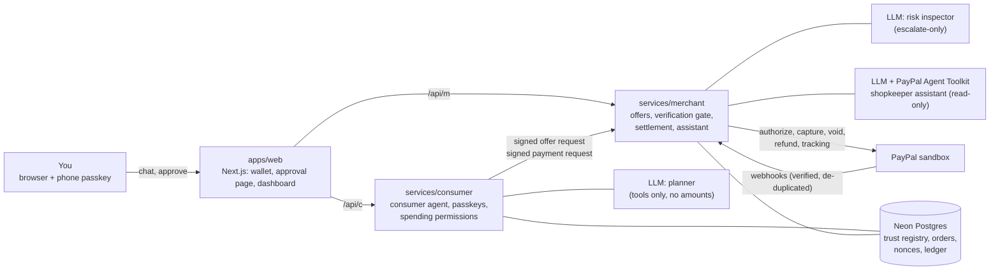

# Handshake

**Agents can shop for you, but only you can approve the payment, and every agent proves who it is.**

Handshake is a payment layer for personal AI agents, built for the PayPal AI Hackathon. A consumer agent buys from a merchant agent. The human approves the exact cart with a passkey (Face ID or fingerprint). Both agents sign what they send, and each signature is checked against a trust registry. Money moves only through PayPal: authorize, capture on fulfilment, void on failure.

- Live demo: https://handshake-web-debi.onrender.com. Hosting is free, so the landing page wakes the services first, which takes about a minute from cold.
- Wallet: `/wallet`. Merchant dashboard: `/merchant`.

## The problem

> "If you think about consumer agents buying from merchant agents, both will have to validate that this is a real consumer" … and "a real merchant that has the product."
> — Enrique Lores, CEO, PayPal, Q3 2026 earnings call (27 Oct 2026), as reported by [PYMNTS](https://pymnts.com/news/artificial-intelligence/2026/paypal-advances-ai-plans-bnpl-payment-volume-rises-25percent)

Handshake is that validation, working today on PayPal.

Personal AI agents are starting to buy on our behalf, but two things are missing:

1. **Proof that the human approved this exact payment.** A chat transcript where the user said "yes" is not consent to a specific amount, payee and set of items.
2. **Proof that each agent is who it claims to be.** A merchant agent can be spoofed, and a consumer agent's request can be altered in transit.

An LLM in the loop makes both worse: a prompt injection in a product description can change what the agent decides to buy.

## What it does

1. You tell your agent what you want: "buy one Basmati rice from Corner Grocery".
2. The agent finds the merchant, asks for an offer, and checks the offer's signature against the registry. Prices come only from the merchant's signed offer, never from the LLM.
3. **Approval.** Your phone shows the merchant, every item, the total and the ship-to address. Face ID signs a hash of exactly that cart. Alternatively, a spending permission you signed earlier with your passkey (per-order and per-period limits, chosen merchants and categories) covers small purchases with no approval step.
4. The merchant's verification gate checks, in order: schema, replay, agent signature, offer signature, cart equals offer, passkey or permission, nonce and expiry, then a risk inspector. Any failure stops the payment with a named error code.
5. PayPal authorizes the payment and holds the money. The merchant captures it only after marking the order fulfilled, and adds tracking. A failed fulfilment or an expired hold voids the authorization.
6. The merchant dashboard streams every decision live. A shopkeeper assistant explains orders and proposes refunds, which the merchant must confirm.

### Attacks it blocks

`pnpm attack` runs 96 cases: 3 valid controls and 93 attacks. Each case starts from a valid signed request and changes one thing: raised amount, swapped payee, forged merchant, replayed approval, missing user verification, rolled-back sign count, over-limit permission, prompt injection, duplicate requests, and more. Result: **96/96 pass, 0 unauthorized authorizations, 0 duplicate charges** (`docs/EVAL.md`). The merchant dashboard's **Attack demo** panel sends three of these to the live gate: amount changed after approval, fake merchant agent, and replayed approval.

## Architecture



| Part                | What it holds                                                                                                       |
| ------------------- | ------------------------------------------------------------------------------------------------------------------- |
| `packages/core`     | Schemas, canonical JSON (RFC 8785), SHA-256 hashing, Ed25519 signing, error codes. No I/O.                          |
| `packages/db`       | Prisma schema and client, shared by both services.                                                                  |
| `services/consumer` | Consumer agent (LLM planner with tools), passkey registration and login, cart approvals, spending permissions.      |
| `services/merchant` | Catalog, signed offers, the verification gate, PayPal settlement, webhooks, dashboard stream, shopkeeper assistant. |
| `apps/web`          | Wallet, phone approval page, merchant dashboard, landing page.                                                      |
| `tests/attacks`     | The adversarial suite.                                                                                              |
| `tests/e2e`         | Playwright end-to-end run against the deployed demo.                                                                |

**Trust rules:**

- Every signed value carries a `type`, a nonce and an expiry.
- The passkey challenge is the hash of the exact cart. The merchant re-verifies the assertion itself, against the registry's public key.
- An LLM never decides an amount, payee, currency or approval. The risk inspector can only ask for step-up or block.
- Every check fails closed with a named error code.

The full design is in `docs/SPEC.md`. `docs/DECISIONS.md` records why each choice was made.

## PayPal features used

- **Orders v2 with `intent: AUTHORIZE`.** Money is held, not taken, until the merchant fulfils.
- **Authorization capture and void.** Capture on fulfilment; void on failed fulfilment, an expired hold or a declined capture.
- **Saving the PayPal wallet with the first purchase** (`store_in_vault: ON_SUCCESS`). Later agent purchases authorize with the saved wallet, with no PayPal redirect. The passkey approval stays the per-order consent.
- **Refunds** of captures, proposed by the assistant and confirmed by the merchant.
- **Shipment tracking**, added after capture.
- **Webhooks.** Every event is signature-checked with `verify-webhook-signature` and de-duplicated by event id. The order state only moves on confirmed events.
- **`PayPal-Request-Id`** on every POST, so retries never double-charge.
- **PayPal Agent Toolkit** (`@paypal/agent-toolkit`) for the shopkeeper assistant. Only read-only tools are enabled, and the code refuses to start otherwise.

Everything runs against the PayPal sandbox (`api-m.sandbox.paypal.com`). The client refuses any other base URL.

## AI used, and how

**In the product.** All three roles use an OpenAI-compatible LLM; the demo runs `openai/gpt-oss-120b` on Groq.

| Role                 | Can do                                                                                                         | Can't do                                       |
| -------------------- | -------------------------------------------------------------------------------------------------------------- | ---------------------------------------------- |
| Consumer planner     | Read your request, pick items, call tools (discover merchants, catalog, request offer, verify offer, checkout) | Set amounts, skip approval, edit signed data   |
| Risk inspector       | Flag prompt injection and anomalies, which escalates to step-up or block                                       | Approve, or lower a risk                       |
| Shopkeeper assistant | Answer questions about orders and decisions with PayPal Agent Toolkit data, propose refunds                    | Move money without the merchant's confirmation |

Merchant text such as product names reaches the LLMs marked as untrusted data. Any risk-inspector answer that isn't well-formed counts as step-up.

**To build it.** The project was built with Claude Code (Anthropic). The repo's agent setup is in `.claude/`: project rules, milestone skills, and subagents for PayPal doc lookups, test runs, security review of payment code, and red-team attack cases. Every change to payment or crypto code went through the security-review subagent before commit.

## Try the live demo

PayPal sandbox only: no real money moves.

1. Open https://handshake-web-debi.onrender.com and wait for the services to wake.
2. **Wallet** (`/wallet`): sign up with a passkey and add an address.
3. Ask the agent to "buy one Basmati rice from Corner Grocery".
4. Open the approval page (on your phone, or in the same browser) and approve with Face ID or your fingerprint.
5. The first purchase sends you to PayPal: log in with the sandbox buyer account and approve. Back in the wallet, confirm the PayPal payer with your passkey. Later purchases skip PayPal.
6. **Merchant** (`/merchant`): sign in with the admin token. Fulfil and capture the order, watch the live decision feed, ask the assistant, refund, and try the three buttons in the Attack demo panel. Reset demo clears payment data.

**Judges:** the PayPal sandbox buyer login and the merchant admin token are in the Devpost testing instructions. They are kept out of this public repo.

## Run it locally

You need Node 24, pnpm, a Neon Postgres database (free tier), a PayPal sandbox app with a webhook, and an OpenAI-compatible LLM key (Groq works). There is no Docker.

```sh
pnpm install
cp .env.example .env    # fill in Neon, PayPal sandbox and LLM values
pnpm keys:gen           # paste the agent keys into .env
pnpm db:migrate
pnpm db:seed            # registry, merchant, catalog
pnpm paypal:webhook     # subscribe the sandbox webhook (needs a public URL for the merchant)
pnpm dev                # web :3000, merchant :4001, consumer :4002
```

Then open http://localhost:3000. Passkeys work on `localhost` in a desktop browser; phones need HTTPS, so use the deployed demo for the phone test.

**Checks:**

| Command                       | What it runs                                                                              |
| ----------------------------- | ----------------------------------------------------------------------------------------- |
| `pnpm typecheck`, `pnpm lint` | Static checks                                                                             |
| `pnpm test`                   | Unit tests                                                                                |
| `pnpm test:db`                | Unit tests plus database tests against Neon                                               |
| `pnpm attack`                 | Attack suite; regenerates `docs/EVAL.md`                                                  |
| `pnpm paypal:smoke`           | Live sandbox calls                                                                        |
| `pnpm e2e:deployed`           | Playwright run against the deployed demo, with a virtual passkey and a real sandbox buyer |

## Built during the hackathon

Everything in this repo was written during the hackathon, starting from the first commit on 29 Oct 2026. Nothing was carried over from earlier work. This includes the canonical JSON and signing library, passkey cart approvals, spending permissions, the verification gate, PayPal settlement and webhooks, the web app, the attack suite, and the deployment on Render. `docs/PLAN.md` lists the milestones, and the git history shows the order they were built in.

## Known limitations

- **AP2-inspired, not AP2.** Mandates, cart approvals and agent signatures follow the ideas of Google's Agent Payments Protocol, not its wire format.
- **The trust registry is database tables.** Agent keys, merchant to PayPal merchant id bindings and passkey keys live in `registry_*` tables. In production this would be a PayPal-operated registry.
- **Sandbox only.** No live PayPal calls; the client rejects any non-sandbox URL.
- **PayPal sandbox shapes not yet observed.** Three PayPal behaviours are handled from the documentation but haven't been seen in the sandbox:
  - The `PAYMENT.CAPTURE.REVERSED` webhook's resource shape. We treat it as refund-shaped and follow its `up` link, like `PAYMENT.CAPTURE.REFUNDED`, which is confirmed.
  - Which payer fields the authorize response carries. We read `payment_source.paypal.account_id`, then `payer.payer_id`.
  - Whether PayPal accepts a void after a declined capture. A refused void is logged for a human, and the authorization expires on its own.

  Details and sources are in `docs/PAYPAL.md` (lines marked **VERIFY**).

- **Demo deployment.** The judging deploy runs on the Neon `dev` branch with `DEMO_MODE` on (D30), so Reset demo and the attack panel work. Reset wipes payment data. Render's free tier sleeps when idle.
- **Saved PayPal wallet across devices.** A saved wallet becomes usable only when the owner approves on PayPal in the same browser where their wallet is signed in (D31). Approving on another device still authorizes the order, and the next order asks PayPal again.
- **Return-secret privacy depends on PayPal.** The wallet-binding secret travels in the order's PayPal `return_url` (D31). A sandbox probe (`pnpm --filter @handshake/e2e return-probe`) showed that PayPal's checkout page includes that URL for anyone who opens the approve link and logs in to PayPal, even without approving. So a determined order owner can read the secret and still bind a phished buyer's PayPal to their own account. The fix would be a payer-side check at the passkey confirm step; it isn't built.

## License

MIT, see `LICENSE`.
